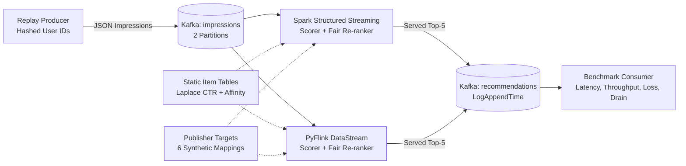

# Recommender at Scale: Latency, Cost and Popularity Bias

**Course Project**: Big Data Systems (Demo: 2 Nov 2026)  
**Team**:  
- Sripada Krishna Sameer Aditya (PES1UG24AM285)  
- Shree Verdhan M (PES1UG24AM265)  
- Shrivamshi Chikkireddi (PES1UG24AM287)  

---

## 1. System Architecture

The pipeline evaluates streaming news recommendations under varying load and exposure-fairness constraints across Apache Spark Structured Streaming and Apache Flink (PyFlink):



---

## 2. Clean-Clone Setup & Reproduction

### Prerequisites
- Linux OS (Ubuntu 22.04+ recommended)
- Python 3.11 with `venv`
- Docker and Docker Compose (v2+)
- GNU Make

### Step-by-Step Instructions

1. **Clone Repository and Set Up Environment**:
   ```bash
   git clone https://github.com/krishna28-sam/Recommender-at-Scale-Latency-Cost-and-Popularity-Bias.git ~/Big_Data
   cd ~/Big_Data
   python3.11 -m venv .venv
   source .venv/bin/activate
   pip install --upgrade pip
   pip install -r requirements.txt
   ```

2. **Configure Security & User Privacy**:
   Set an arbitrary local secret salt for user ID pseudonymization (SHA-256):
   ```bash
   export MIND_USER_HASH_SALT="local-secure-salt-2026"
   ```

3. **Stage Data & Build Offline Feature Tables**:
   Download real MIND-small (`make data` fetches from the official Microsoft Research Azure Blob endpoint, with automatic fallback to the Hugging Face dataset mirror if blocked):
   ```bash
   make data
   make eda
   make mappings
   make tables
   make predictions
   make offline
   make hash-users
   ```
   > **Note on Data Access**: Raw data is governed by the Microsoft Research License Terms of Use. If automated downloads are blocked by network firewalls, manually place `MINDsmall_train.zip` and `MINDsmall_dev.zip` into `data/raw/` before running downstream make targets.


4. **Run Unit Tests & Smoke Verification**:
   ```bash
   make test
   make smoke
   ```

5. **Direct Engine Execution & Container Verification**:
   ```bash
   # Start Kafka message broker
   docker compose up -d kafka

   # Run Spark Structured Streaming engine
   docker compose --profile spark run --rm spark

   # Run Apache Flink (PyFlink) streaming engine
   docker compose --profile flink run --rm flink
   ```

6. **Summarize Matrix, Render Notebook & Build Report**:
   ```bash
   make summarize
   make notebook
   make report
   ```

---

## 3. Makefile Targets Reference

| Target | Description | Output Path |
| :--- | :--- | :--- |
| `make test` | Runs static compilation check and full pytest suite | Terminal stdout |
| `make data` | Downloads MIND-small train and dev archives from Hugging Face | `data/raw/` |
| `make eda` | Computes dataset statistics and schema validation | `data/processed/eda.json` |
| `make mappings` | Generates 6 synthetic publisher mappings (3 random, 3 category) | `data/processed/publishers/` |
| `make tables` | Precomputes Laplace-smoothed CTR tables and category histories | `data/processed/model_tables/` |
| `make predictions`| Evaluates model predictions across 7 $\lambda$ values and 6 mappings | `data/outputs/dev_predictions/` |
| `make offline` | Computes ranking quality and publisher exposure metrics | `data/processed/bias_summary.csv` |
| `make hash-users` | Generates salted SHA-256 hashed user behaviors for streaming replay | `data/processed/dev_behaviors_hashed.tsv` |
| `make smoke` | Runs end-to-end 30s transport smoke test through Kafka | Terminal stdout |
| `make probe` | Runs single-variable capacity probe across 100..4000 ev/s | `logs/probe_report.csv` |
| `make matrix` | Runs 42-cell matrix benchmark (7 configs $\times$ 2 rates $\times$ 3 reps) | `bench/results/*.csv` |
| `make summarize` | Aggregates 42 matrix runs and computes rerank overhead | `data/processed/analysis/` |
| `make bootstrap` | Computes impression-level bootstrap confidence intervals | `data/processed/analysis/bootstrap_summary.json` |
| `make notebook` | Executes `notebooks/results.ipynb` and renders 6 benchmark charts | `notebooks/results.ipynb` |
| `make report` | Generates 3-5 page formatted Word document from real evidence | `report/report.docx` |

---

## 4. Data Licensing & Citations

- **Primary Dataset**: Microsoft News Dataset (MIND-small), hosted via Hugging Face (`Recommenders/MIND`), governed by the **Microsoft Research License Terms**.
  - **Citation**: Fangzhao Wu, Ying Qiao, Jiun-Hung Chen, Chuhan Wu, Tao Qi, Jianxun Lian, Danyang Liu, Xing Xie, Jianfeng Gao, Winnie Wu, and Ming Zhou. 2020. *MIND: A Large-scale Dataset for News Recommendation*. In Proceedings of the 58th Annual Meeting of the Association for Computational Linguistics (ACL 2020), pages 3597–3606.
- **Fallback Dataset**: MovieLens-25M (used strictly as an offline fallback pipeline; never feeds MIND reported metrics).
  - **Citation**: F. Maxwell Harper and Joseph A. Konstan. 2015. *The MovieLens Datasets: History and Context*. ACM Transactions on Interactive Intelligent Systems (TiiS) 5, 4, Article 19 (December 2015), 19 pages. DOI: https://doi.org/10.1145/2827872

---

## 5. Untracked Files & Data Hygiene

In compliance with dataset license terms and submission size limits, the following paths are excluded from version control via `.gitignore`:
- `data/raw/`: Raw downloaded zip archives and extracted TSVs.
- `data/outputs/`: Per-impression dev prediction JSONL files (~73,152 lines $\times$ 42 files).
- `data/movielens_derived/`, `data/processed_movielens/`, `data/outputs_movielens/`: Fallback artifacts.
- `.venv/`: Local virtual environment.
- `logs/*.log`: High-volume runtime engine execution logs.

---

## 6. Requirement-to-Evidence Mapping

| Project Requirement | Implementation Evidence Path | Verification Method / Metric Source |
| :--- | :--- | :--- |
| **Data Provenance & Privacy** | `cards/data_card.md`, `scripts/hash_users.py` | SHA-256 verified in `data/raw/mind_small.sha256`; zero raw user IDs in stream |
| **Model & Fair Re-Ranker** | `recsys/scorer.py`, `recsys/reranker.py`, `cards/model_card.md` | Laplace CTR ($\alpha=10$) + greedy exposure penalty ($\lambda \in [0.0, 5.0]$) |
| **Spark Streaming Pipeline** | `spark/pass_through.py`, `docker/spark.Dockerfile` | Micro-batch streaming with configurable trigger (`PROCESSING_TIME`) |
| **PyFlink Streaming Pipeline** | `flink/pass_through.py`, `docker/flink.Dockerfile` | Event-driven DataStream with bundle buffer tuning (`python.fn-execution.bundle.time = 50ms`) |
| **Capacity Probe** | `bench/probe.py`, `logs/probe_report.csv` | 6 rates (100 to 4,000 ev/s) across 7 configs; saturation detected at $\ge 2,000$ ev/s |
| **42-Run Benchmark Matrix** | `bench/run.py`, `bench/results/*.csv` | 7 configs $\times$ 2 rates (1000, 2000) $\times$ 3 reps; 60s windows; Kafka log timestamps |
| **Matrix Summary & Rerank Overhead** | `data/processed/analysis/matrix_summary.csv`, `rerank_overhead.csv` | `make summarize` (`bench/summarize_matrix.py`); p50/p95 latency, backlog, CPU/1k |
| **Offline Bias Tradeoff** | `bias/offline_metrics.py`, `data/processed/bias_summary.csv` | Pareto frontier: Exposure L1 vs. Served nDCG@5 across 6 publisher mappings |
| **Bootstrap Confidence Intervals** | `bias/bootstrap.py`, `data/processed/analysis/bootstrap_summary.json` | 1,000 resamples of impression sessions for Exposure L1, Gini, and nDCG |
| **Visual Analysis Notebook** | `notebooks/results.ipynb` | Executed Jupyter notebook loading real data dynamically; 6 rendered PNG charts |
| **Technical Report** | `report/report.docx` (built via `report/build_report.py`) | 3–5 page technical paper citing exact metrics and ASSUMED cost models |
| **Demonstration Script** | `docs/demo_script.md` | 3-minute presentation script (20s/30s/60s/50s/20s) with Docker fallback plan |

---

## 7. Troubleshooting & Resource Requirements

- **System Resources**: Requires at least 8 GB RAM (16 GB recommended for concurrent multi-container benchmark execution) and 20 GB free disk space for raw and processed datasets.
- **Linux Cgroups v2**: Resource accounting relies on Linux cgroup v2 controller interface (`/sys/fs/cgroup/cpu.stat` or `memory.peak`). When running inside restricted containers, fallback heuristic monitors are automatically activated.
- **Port Conflicts**: Kafka exposes listener port `29092` locally and `9092` inside Docker. If `29092` is already in use by a local Kafka instance, stop the conflicting daemon or export a custom `BOOTSTRAP_SERVERS` port.
- **Historical Event ID Limitations**: Streaming runs generate live random UUID4s into Kafka; historical benchmark logs validate distinct event counts and schema fields rather than matching an offline ID manifest. Full set-equality validation is supported via `--expected-input`.
